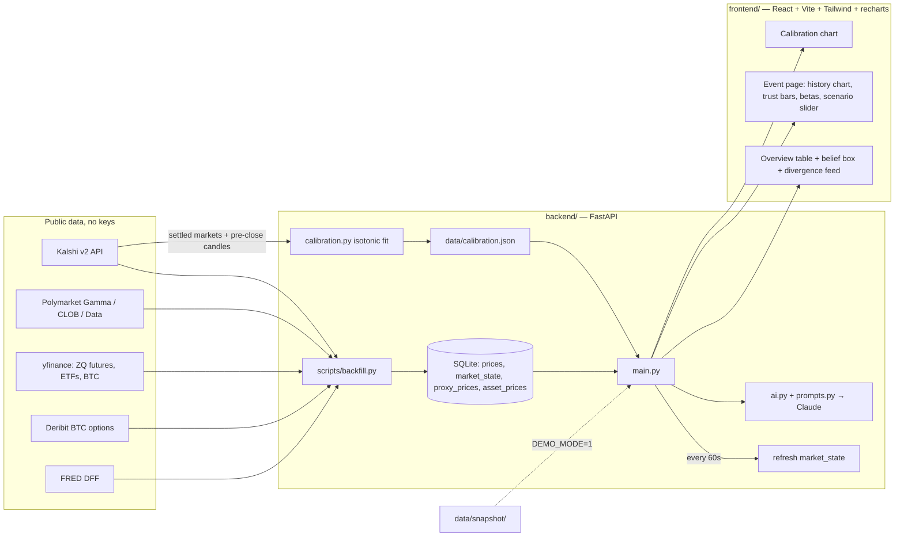

# Basis — a trust layer for prediction markets as financial signals

Prediction markets now trade tens of billions a month and trading desks are starting to read them as
signals. But raw odds are biased (favorite–longshot bias), often thin, and sometimes lag the real market.
**Basis** tells you which prediction-market prices are actually a signal:

- a **calibrated probability** (isotonic fit on thousands of settled Kalshi markets),
- the **basis** — divergence from the traditional market's implied probability (fed-funds futures, BTC options),
- a **0–100 trust score** (liquidity, spread, freshness, holder concentration, horizon) plus a leakage flag,
- **event betas** — what assets co-move if the odds flip, with a scenario slider,
- a **"type your belief"** box that maps plain English to events and explains the disagreement (Claude).

## Run it in 3 commands

```bash
make setup        # uv venv + pip deps + npm install
make backfill     # pull Kalshi / Polymarket / yfinance / Deribit → data/basis.db + data/calibration.json  (~5 min)
make dev          # FastAPI on :8000 + Vite on :5173 (or next free port)
```

No API keys needed for data. Copy `.env.example` to `.env` and set `ANTHROPIC_API_KEY` for the belief box
(without it the box falls back to keyword matching and a templated explanation).

**Demo mode** (never calls an external API, serves the committed snapshot):

```bash
make demo         # DEMO_MODE=1
make snapshot     # regenerate data/snapshot/ from the live DB
make smoke        # hit every endpoint once
```

## Architecture



### How each number is made

| Output | Method | Code |
|---|---|---|
| Calibrated p | Settled Kalshi markets sampled over ~180 days; price ≈1 day before close (daily candlestick) vs. YES rate; 5¢ bins; `IsotonicRegression(out_of_bounds="clip")` | `backend/calibration.py`, `backend/clients/kalshi_settled.py` |
| Proxy p (fed funds) | `P(move) = clip((implied_after − baseline)/0.25, 0, 1)` with implied = 100 − futures price; baseline = contract for the month before the meeting, else FRED DFF | `backend/basis.py:fedfunds_series` |
| Proxy p (BTC) | risk-neutral `N(d2)` from the nearest-strike Deribit call's mark IV and underlying | `backend/basis.py:btc_prob_above` |
| Basis, z | `p_pm − p_proxy`; rolling 30-obs z-score of the daily basis series | `backend/basis.py:basis_stats` |
| Trust 0–100 | liquidity 0.35 · spread 0.25 · freshness 0.20 · concentration 0.20, × horizon multiplier; leakage flag if one trade > 5% of 24h volume | `backend/trust.py` |
| Betas | OLS of asset daily % return on daily pp change in event probability; reports β, R², n | `backend/betas.py` |

## API

`GET /events` · `GET /events/{id}` · `GET /calibration` · `POST /scenario {event_id, p_new}` ·
`POST /belief {belief}` · `GET /divergence` · `GET /arb` · `GET /health`

## Event map

`data/events.json` is hand-curated (16 events: FOMC Oct/Dec/Sep-settled, CPI, BTC strikes, Iran, Ukraine, Taiwan,
House, recession, Fed-chair). Matching across venues is *not* solved generically. Real API shapes are recorded in
`data/api_notes.md`.

## Honest limitations

- **Risk-neutral ≠ real-world.** `N(d2)` carries no risk premium; it is also a *terminal* probability while
  "reach $K in October" markets are *touch* events (roughly 2× more likely for small moves). Expect BTC basis to look positive.
- **Fed-funds approximation.** Treats a 50bp move as two 25bp moves, ignores term premium and intra-month timing.
  When FRED is down (it was during the build) the settled-September baseline is synthesised from the post-meeting
  contract minus the realised move and labelled as such in `proxy_detail`.
- **Co-movement, not causation.** Betas use ≤ 1 year of daily data; R² is small; common drivers dominate.
- **Small samples.** The calibration sample is 628 Kalshi markets over ~12 months (pre-close candles only; markets with no trades before the final day are dropped), skewed to whatever Kalshi
  listed; high-price bins have tens of observations. Polymarket calibration is not estimated.
- **Holder concentration** comes from Polymarket's top-20 holder list only (Kalshi exposes none → 0.5 default).
- **Trust is heuristic.** Weights are hand-set, not learned.
- No auth, no websockets, no tests beyond `scripts/smoke.py`. Any upstream failure degrades to the last cached
  response and a visible "stale" badge.
